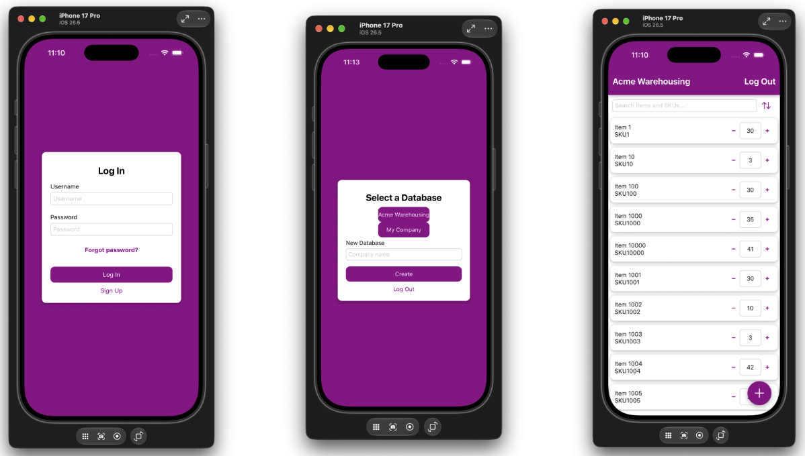

# 📦 Inventory Warehouse 📦

Keep your business organized with Inventory Warehouse, a simple and secure way for small businesses to manage inventory from anywhere. Create an account, connect to your company, view and update stock levels, and add new items in just a few taps. Inventory Warehouse will be available for Android and iOS.

## Screenshots



## 👋 Get started

1. Install dependencies

   ```bash
   npm install
   ```

2. Start your local MongoDB server

   ```bash
   brew services start mongodb-community
   ```

   Verify that MongoDB is available:

   ```bash
   mongosh
   ```

   Generate the `.env` file using:

   ```bash
   npm run setup-env
   ```

   This writes `MONGODB_URI`, a randomly generated `JWT_SECRET`, and `JWT_EXPIRES_IN=1d`. It won't overwrite an existing `.env` unless you add `-- --force`:

   ```bash
   # overwrite the secret
   npm run setup-env -- --force

   # use a different database
   npm run setup-env -- --uri=<your-mongodb-uri>
   ```

3. Seed the database

   > 🚨WARNING🚨: THIS WILL DELETE ALL CURRENTLY EXISTING DATA FOR THE INVENTORY WAREHOUSE DATABASE IF ALREADY CREATED.

   ```bash
   npx tsx src/seed.ts
   ```

   > 🙋‍♀️ The seeded username is `janedoe` with a password of `password123`.

4. Start the app

   ```bash
   npx expo start
   ```

In the output, you'll find options to open the app in a

- [Development build](https://docs.expo.dev/develop/development-builds/introduction/)
- [Android emulator](https://docs.expo.dev/workflow/android-studio-emulator/)
- [iOS simulator](https://docs.expo.dev/workflow/ios-simulator/)
- [Expo Go](https://expo.dev/go)

## Technologies Used

- [React Native Expo](https://expo.dev/home)
- [Expo Server](https://docs.expo.dev/versions/latest/sdk/server/)
- [MongoDB](https://www.mongodb.com/)
- [Mongoose](https://mongoosejs.com/)
- [JWT](https://www.jwt.io/)
